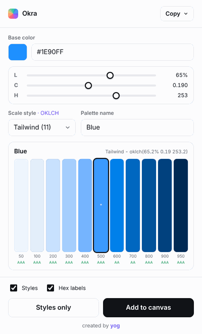

<div align="center">

# Okra

### OKLCH color palette generator for Figma

Build perceptually even color scales that stay true to your hue, drop them on the canvas with auto layout, and turn them into Figma color styles in one click.

Pick a color. Pick a scale. Ship a palette.

<br />



</div>

---

## Why this exists

Most palette tools build shades in HSL or RGB. The problem shows up the moment you darken or lighten a color: the lighter steps drift toward a different hue and the darker ones go muddy and grey. You end up hand correcting every swatch.

Okra builds every shade in **OKLCH**, a perceptually uniform color model. It changes only the lightness across a scale while the hue stays locked, so a blue stays blue from the lightest tint to the darkest shade.

<div align="center">

| | Lightest &rarr; Darkest |
|:--|:--|
| **OKLCH** | consistent blueness across all steps |
| **HSL** | light steps drift to purple, dark steps go grey |

</div>

---

## What is OKLCH

OKLCH is a newer color model designed around how humans actually perceive color. Like the older LCH, it describes a color with three values, but it sits on top of the OKLab color space, which makes it far more predictable to work with.

Every color is three numbers:

| Value | What it controls | Range |
|:--|:--|:--|
| **L** &nbsp; Lightness | how bright the color is | `0` to `1` (or 0% to 100%) |
| **C** &nbsp; Chroma | how intense the color is, like saturation | `0` upward |
| **H** &nbsp; Hue | the hue angle on the color wheel | `0` to `360` |

```css
oklch(0.65 0.19 253)
       L    C    H
```

### Consistent brightness

Keep the same L, change only H, and every color feels like it belongs to the same family. Four buttons at `oklch(0.50 0.16 ...)` with different hues read as equally bright. Try that in HSL and some pop while others sink.

### Predictable shades

This is the heart of Okra. Move only the lightness and you get a clean scale with no hue or saturation drift. The color you started with stays recognisable at every step. That is exactly how Okra generates a 50 to 950 ramp from a single base color.

### Gamut

A gamut is the range of colors a screen can actually show. sRGB is the web default, Display P3 covers modern devices. OKLCH can describe colors beyond any real screen, so Okra maps any out of gamut shade back into sRGB by gently reducing its chroma while holding the lightness and hue steady. Your palette always lands on colors that render correctly.

> Want to go deeper on the theory, play with the values, and see it all live? The reference below is the best place to start.

---

## Features

- **Set the base color** by picker, by sliders (OKLCH L, C, H), or by typing it in **HEX, RGB, HSL, or OKLCH** with a format switcher
- **Scale styles** from a dropdown: Tailwind, Material, Ant Design, Atlassian, Semantic, and a Custom scale where you choose the number of colors
- **Auto naming**: the palette is named from its hue (Blue, Emerald, Violet), and you are free to rename it
- **Live preview** of every shade with the base step marked
- **WCAG 2 contrast badge** on each shade, so you know what passes AA or AAA before you use it
- **Copy as code**: CSS variables (hex), CSS variables (oklch), Tailwind config, or a plain hex list
- **Add to canvas** as a clean auto layout card with hex labels
- **Create Figma color styles** named `Name/step`, for example `Blue/500`, each carrying its **hex and OKLCH value in the style description** (Figma's own picker has no OKLCH format, so the value lives on the style)
- **One screen, no scrolling**, with light and dark UI

---

## Scale styles

Every scale is generated in OKLCH. These presets are naming and step count templates, not reproductions of each brand's exact colors. They give you a clean OKLCH scale in a naming convention your project already uses.

| Style | Steps | Naming |
|:--|:--|:--|
| Tailwind | 11 | 50 to 950 |
| Material | 10 | 50 to 900 |
| Ant Design | 10 | 1 to 10 |
| Atlassian | 7 | 50 to 500 |
| Semantic | 7 | lightest to darkest |
| Custom | 5 to 14 | your choice |

---

## Install

Okra runs as a development plugin, no build step needed.

1. Clone or download this repo and keep these files together in one folder:
   `manifest.json`, `code.js`, `ui.html`, `color.js`
2. In the Figma desktop app go to **Plugins &rarr; Development &rarr; Import plugin from manifest**
3. Select `manifest.json`
4. Run it any time from **Plugins &rarr; Development &rarr; Okra**

---

## How it works

```
OKLCH base  ->  per step: set lightness, hold hue, scale chroma
            ->  OKLab  ->  linear sRGB
            ->  gamut map (reduce chroma if out of range)
            ->  sRGB hex  ->  swatches, styles, and exports
```

| File | Role |
|:--|:--|
| `manifest.json` | Plugin manifest |
| `code.js` | Figma main thread: draws the canvas card and creates paint styles |
| `ui.html` | Plugin UI with the color engine inlined |
| `color.js` | The OKLCH engine (source), for reference and edits |

Scale curves live in `color.js` under the `*_SCALE` constants. Each stop is an OKLCH lightness `L` from 0 to 1 and a chroma multiplier `cMul` applied to the base color chroma. Tune those to reshape any preset.

After editing `color.js`, re inline it into `ui.html`:

```bash
node -e 'const fs=require("fs");let h=fs.readFileSync("ui.body.html","utf8");h=h.replace("/* ===== OKRA_ENGINE_PLACEHOLDER ===== */",fs.readFileSync("color.js","utf8"));fs.writeFileSync("ui.html",h)'
```

---

## Credits

- **OKLCH learning and reference**: [oklch.fyi](https://oklch.fyi) by [Jakub Krehel](https://x.com/jakubkrehel). A genuinely great resource for understanding and experimenting with OKLCH. The explanation above draws on it.
- **Inspiration**: the Foundation Color Generator plugin, reimagined around OKLCH.

<div align="center">

Created by [**Yog**](https://yogfolio.vercel.app)

</div>
